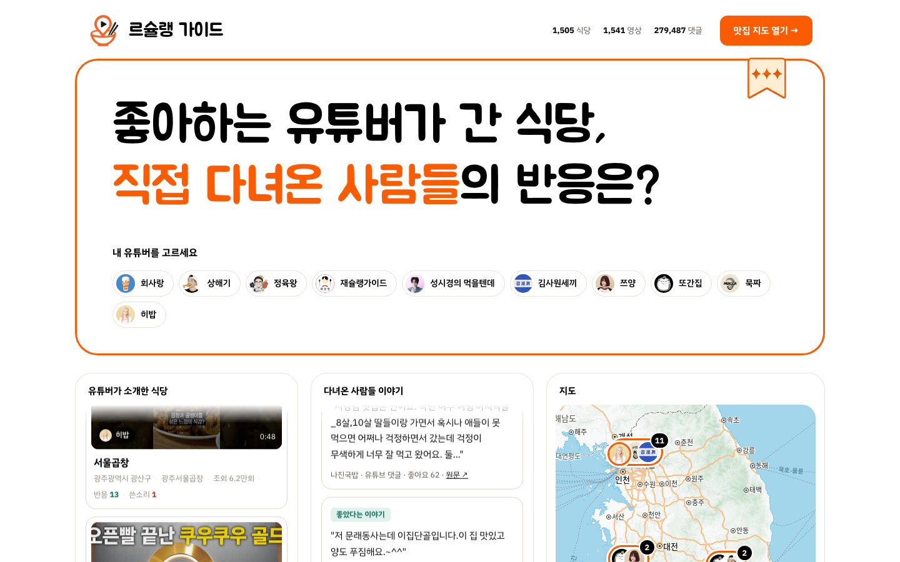
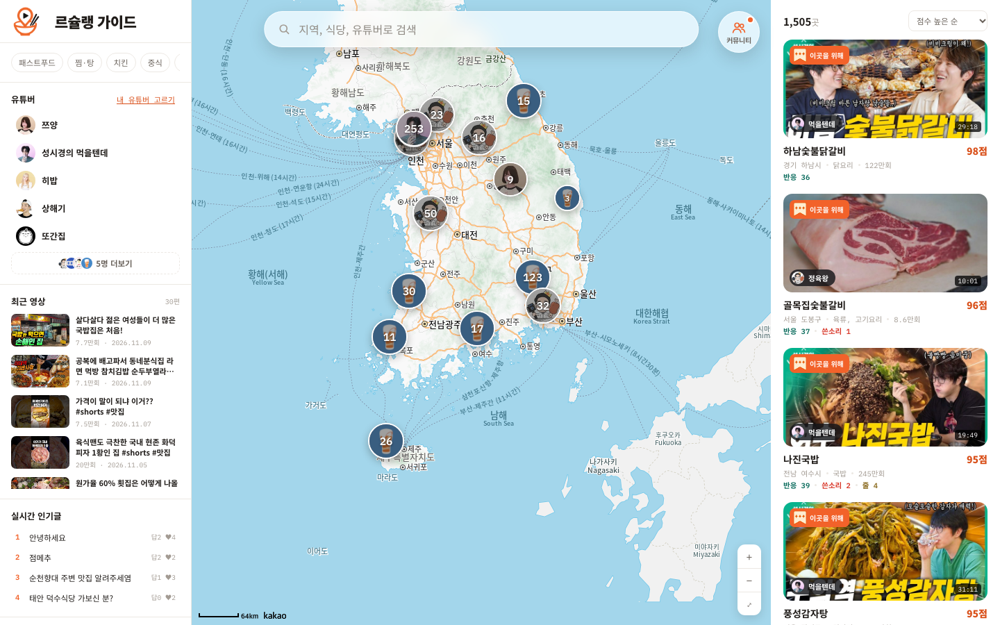
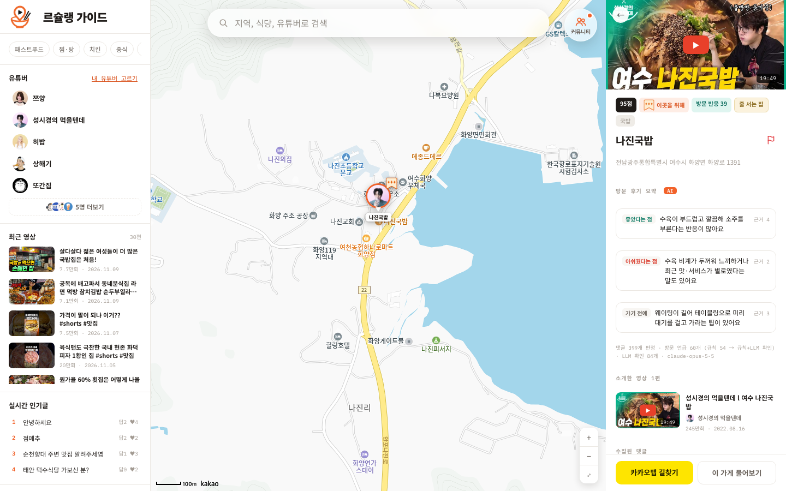
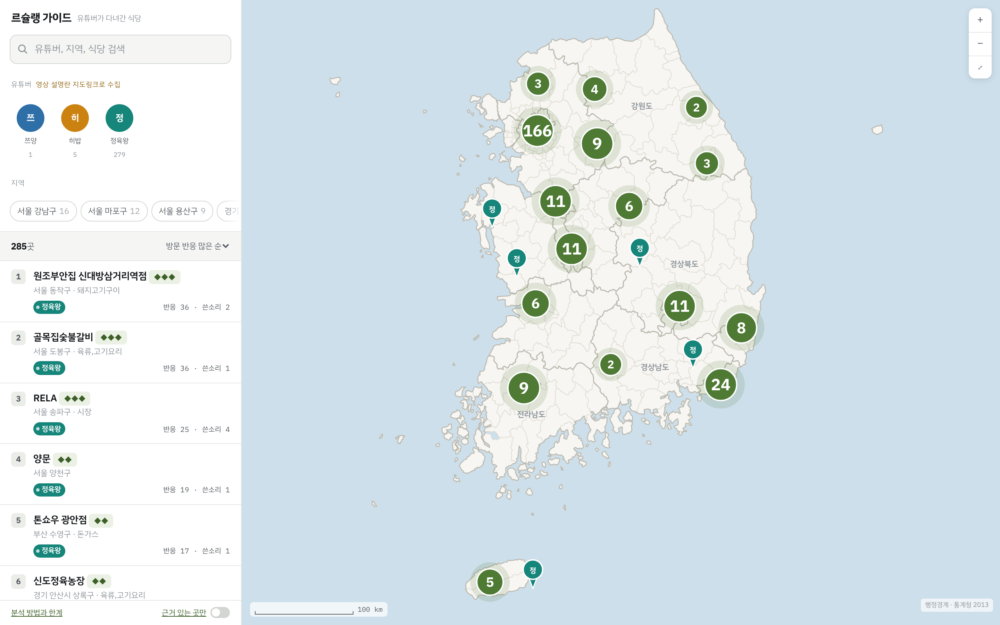
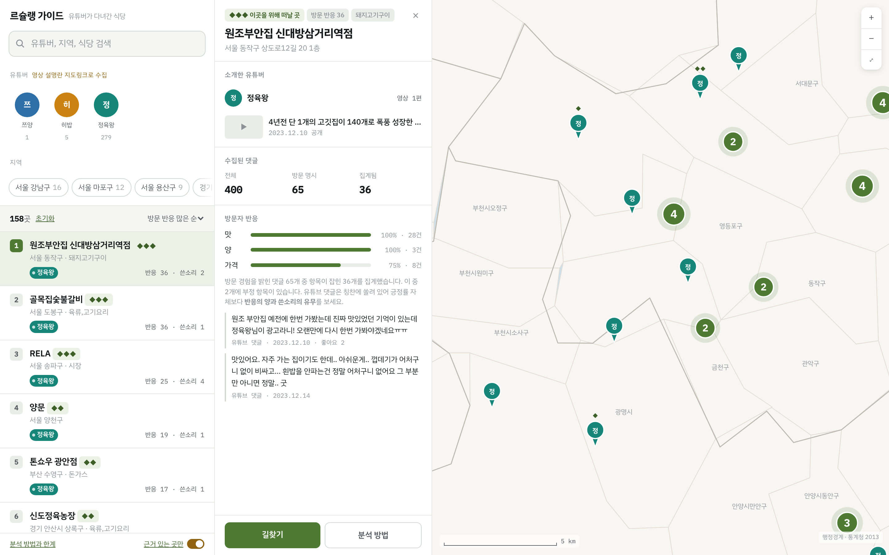
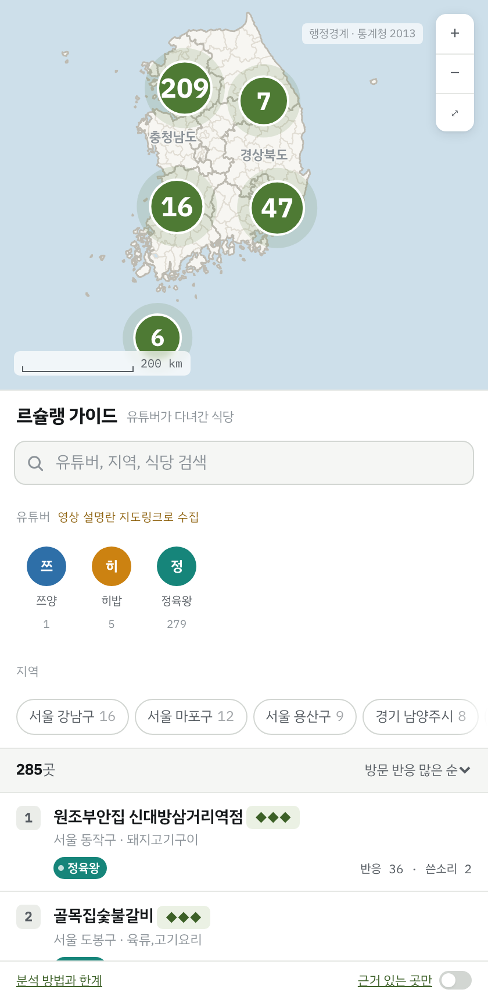
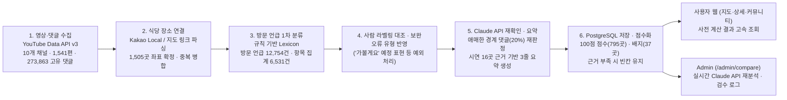
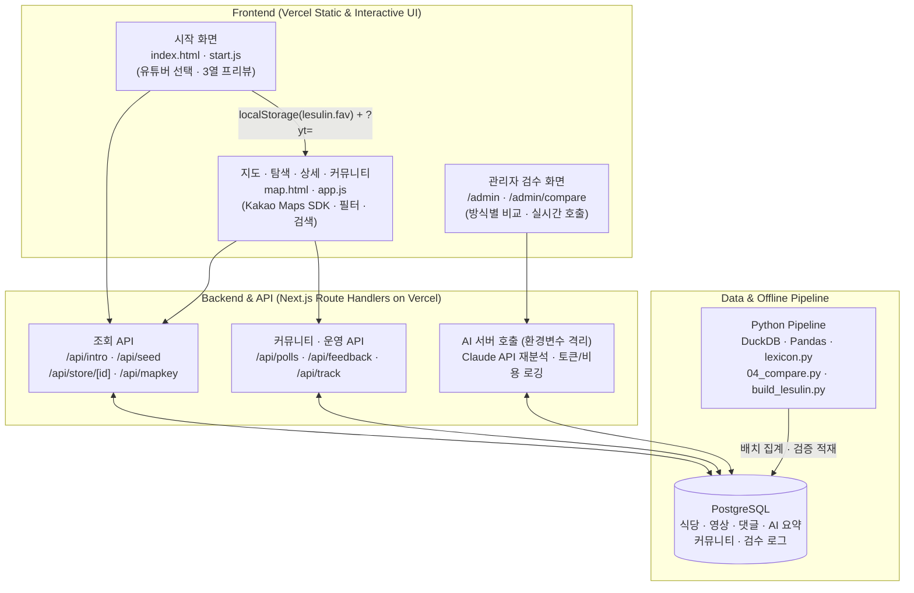

<div align="center">

# 🍽️ 르슐랭 가이드 (Lechelin Guide)

**유튜버 영상에서 찾고, 방문 반응으로 고르는 맛집 가이드**

[](https://lesulin-guide.vercel.app)
[](https://nextjs.org/)
[](https://www.postgresql.org/)
[](https://www.anthropic.com/)
[](https://apis.map.kakao.com/)
[](https://duckdb.org/)

*캡스톤디자인 4조 프로젝트 · 2026.10 ~ 2026.11*

</div>

---

## 📌 한눈에 보는 프로젝트 성과

| 수집 식당 | 연결 영상 | 고유 댓글 (연결 합계) | 점수 산출 · 배지 | 탐색 설문 검증 (`n=105`) | 혼합 분류기 성능 (`n=90`) |
| :---: | :---: | :---: | :---: | :---: | :---: |
| **1,505곳** | **1,541편** | **273,863개** (`279,487건`) | **795곳** · 배지 **37곳** | 탐색 경험 **55.2%** · 이용 의향 **71.4%** | **F1 92.9%** (LLM 호출 **20%**) |

---

## 1. 프로젝트 배경 및 아이디어 도출

### 💡 출발점: "영상을 본 순간과 식당을 고르는 순간은 떨어져 있다"
평소 맛집 유튜브(또간집, 성시경의 먹을텐데 등)를 즐겨 보던 지인이 경주 여행 중 겪은 실제 불편에서 시작했습니다.  
낯선 지역에서 식사를 고를 때 머릿속에 스친 유튜브 맛집을 가려면 사용자는 아래 과정을 매번 따로 거쳐야 했습니다.

1. **영상 다시 찾기** — 채널을 거슬러 올라가 지역·영상 제목 검색
2. **식당 위치 확인** — 상호를 추정해 지도 앱에서 별도 검색
3. **방문 반응 확인** — 촬영 이후 실제로 다녀온 사람들의 최근 반응 따로 탐색

**르슐랭 가이드**는 이 단절된 과정을 **유튜버 선택 → 지도·지역 탐색 → 원본 영상·방문 언급 반응·AI 3줄 요약 → 길찾기**까지 한 화면 흐름으로 연결합니다.

### 🔄 데이터 실증에 기반한 기획 피벗 (Pivot)
초기에는 기업(르몽)에서 제공한 멀티플랫폼 리뷰 데이터(**약 1,490만 건**, 강남구 **209,871건**)를 활용해 배달앱 리뷰 다면 평가 PoC(`web/돌려봄_데모.html`, `web/index.html`)를 먼저 검증했습니다.

| 검증 항목 | 실측 결과 | 기획적 시사점 |
| :--- | :--- | :--- |
| **배달앱 별점 편중** | 배민 **94.4%** · 쿠팡이츠 **94.5%** · 요기요 **91.9%**가 5점<br>강남 후보 55곳 평균 **4.62~4.98** (표준편차 **0.078**) | 단순 평균 별점으로는 매장 간 차이를 설명할 수 없음 |
| **양면시장·매장 겹침률** | 유튜버 방문 식당 **617곳**과 르몽 매장 **32,449곳**의 교집합은 **2곳(0.3%)**<br>(르몽 데이터의 **98.5%**가 배달 리뷰) | 배달 플랫폼 리뷰와 노포·방문형 맛집 데이터는 구조적으로 분리됨 |
| **최종 피벗 방향** | 르몽 리뷰 자체를 억지로 연결하지 않고,<br>구축한 **항목별 감성 사전(Lexicon)과 분석 파이프라인**만 방문형 유튜브 댓글 분석으로 이식 | **데이터의 성격에 맞는 도메인(유튜버 방문 식당)으로 재정의**하고 분석 엔진 자산을 재활용 |

---

## 2. 프로젝트 실행 화면

### ① 시작(인트로) 화면 — 가이드북 온보딩 & 3열 실시간 프리뷰
> **"좋아하는 유튜버가 간 식당, 직접 다녀온 사람들의 반응은?"**  
> 서비스 접속 직후 3초 안에 핵심 가치를 전달하도록 설계했습니다. 최대 10명의 유튜버를 선택할 수 있으며, 하단 3열 프리뷰(`유튜버가 소개한 식당` · `다녀온 사람들 이야기` · `미니 지도`)를 통해 실제 영상과 원문 댓글이 연결되는 구조를 바로 체험할 수 있습니다.



### ② 지도 기반 탐색 화면 — 클러스터 핀 · 랭킹 · 실시간 커뮤니티
> **한 화면에서 끝나는 탐색 동선**  
> 좌측에서 업종 카테고리(`패스트푸드`, `찜·탕`, `치킨` 등), 유튜버(`내 유튜버 고르기`), 최근 영상, `실시간 인기글`과 상세 필터(조회수·방문 반응 수·줄 서는 집·반응이 있는 곳)를 조작하면 중앙 카카오맵과 우측 랭킹 목록이 즉시 동기화됩니다. 내가 고른 유튜버의 식당 핀에는 **주황 테두리와 우선 프로필**이 표시됩니다.



### ③ 식당 상세 & 방문 후기 요약 AI — 근거 원문까지 한눈에
> **결과를 말하기 전에 근거를 먼저 보여줍니다**  
> 우측 상세 패널에서는 **원본 유튜브 영상 썸네일** → **르슐랭 점수(95점) · 배지(이곳을 위해)** → **방문 후기 요약 AI 3줄(`좋았다는 점` · `아쉬웠다는 점` · `가기 전에`)** → **항목별 긍정/부정 막대** → **카카오맵 길찾기** 및 **`이 가게 물어보기`(커뮤니티 연동)**로 이어집니다. 요약 문장을 클릭하면 근거가 된 실제 유튜브 댓글 원문이 펼쳐집니다.



<details>
<summary>📂 초기 PoC 프로토타입 화면 변천사 보기 (2026.10 중간발표 단계)</summary>

초기 PoC 단계에서는 상용 지도 API 키 발급 전 **통계청 행정경계 SVG 지도**를 직접 렌더링해 **285곳** 규모로 사용자 흐름을 선검증한 뒤, 이후 카카오맵 SDK·PostgreSQL·Claude API 기반의 **1,505곳** 실서비스로 확장했습니다.

| PoC 전체 탐색 화면 (285곳) | PoC 식당 상세 카드 | PoC 모바일 반응형 시안 |
| :---: | :---: | :---: |
|  |  |  |

</details>

---

## 3. 데이터 흐름 (Data Flow)

유튜브 영상과 댓글 원천 데이터를 수집한 뒤, **규칙 기반 필터링 + 사람 라벨 보완 + Claude API 하이브리드 재확인**을 거쳐 DB에 적재하고 사용자 화면과 관리자 검수 화면에 제공합니다.



### 🏅 르슐랭 점수(100점) 및 배지 산출 기준
- **방문 반응의 양 (60점)** + **만족 정도 (40점)** 합산 100점 만점
  - 영상 조회수는 채널 구독자 규모 편향이 커서 점수 산출에서 제외
  - 대기(`줄 서는 집`) 항목은 쓴소리 감점 집계에서 분리해 별도 지표로 표시하며, 반응 수가 적은 매장은 전체 평균 쪽으로 보정
- **르슐랭 배지 (37곳 / 전체 1,505곳)**:
  - **95점 이상 (★★★ 이곳을 위해)**: 4곳
  - **90점 이상 (★★ 우회해도 갈 곳)**: 12곳
  - **85점 이상 (★ 들러볼 곳)**: 21곳
- **데이터 신뢰 원칙**: 댓글의 `"다녀왔어요"` 분류는 **방문 인증이 아닌 텍스트 분류 결과**임을 명시하며, 방문 언급 댓글이 부족한 식당은 임의로 추정하지 않고 **근거 부족**으로 비워 둡니다.

---

## 4. 시스템 아키텍처 (System Architecture)



---

## 5. 사용된 기술 스택 및 스킬 (Tech Stack & Skills)

### 🛠️ 기술 스택
| 구분 | 사용 기술 | 적용 영역 |
| :--- | :--- | :--- |
| **Frontend** | HTML5, CSS3, Vanilla JS (`start.js`, `app.js`), Next.js | 가이드북 인트로, 지도/목록 분할 탐색, 드래그 리사이즈 패널, 상세 뷰, 커뮤니티 모달 |
| **Map & External API** | Kakao Maps JavaScript SDK, Kakao Local API, YouTube Data API v3 | 1,505개 식당 클러스터 핀·길찾기, 10개 유튜버 채널 영상 1,541편 및 댓글 27만여 건 수집 |
| **Backend & DB** | Next.js API Routes, PostgreSQL, Vercel | `/api/intro`, `/api/seed`, `/api/store/[id]`, 실시간 익명 커뮤니티(`/api/polls`), Admin API |
| **AI & NLP** | Anthropic Claude API, 규칙 기반 Lexicon (`scripts/lexicon.py`) | 방문 경험 판정 하이브리드 분류, 시연 식당 3줄 요약 및 근거 댓글 ID 매핑 |
| **Data & Verification** | Python, DuckDB, Pandas, `python-pptx`, Pillow | 1,490만 건 대용량 CSV 고속 프로파일링, F1 평가(`04_compare.py`), 슬라이드 넘침 자동 검수(`build_lesulin.py`) |

### 🤖 AI 에이전트 스킬 및 개발 워크플로우
- **`frontend-design` 스킬**: 인트로 화면의 3초 인지성 개선과 서비스 톤앤매너(오렌지/크림/화이트 가이드북 컨셉) 설계·구현에 활용
- **웹 UI · 기능 자동 검수 스킬**: 배포 직전 버튼 동작, 필터 상태 동기화(`?yt=` 파라미터), 썸네일/파비콘 렌더링, 반응형 레이아웃 오류 전수 점검
- **Figma 플러그인 & 인터랙티브 HTML 목업(`web/mockup.html`)**: 화면 설계안 비교(A/B/C안) 및 프론트엔드 구현 연결

---

## 6. 서비스 검증 (Service Validation)

### 📊 1) 사용자 니즈 탐색 설문 (`n = 105`)
> 실제 서비스가 해결하려는 문제 상황을 사람들이 공감하고 사용할 의향이 있는지 검증했습니다.

| 설문 문항 | 응답 결과 (`n = 105`) |
| :--- | :--- |
| **낯선 지역에 갔을 때, 영상에서 본 식당을 찾아본 경험이 있나요?** | **직접 찾아봤다 55.2% (58명)** · 생각은 났지만 안 찾았다 24.8% (26명) · 없다 20.0% (21명) |
| **낯선 지역에서 식당을 고를 때, 본 기능을 사용할 것 같나요?** | **사용할 것 같다 71.4% (75명)** · 상황에 따라 15.2% (16명) · 사용 안 함 10.5% (11명) |

### 🧪 2) 방문 경험 언급 분류기 정량 검증 (`n = 90` 블라인드 표본)
> 처음 보는 댓글 90건에 팀원이 직접 방문 여부를 라벨링한 뒤, 동일 표본에서 3가지 방식을 공정 비교했습니다.

| 분류 방식 | F1 Score | LLM 호출 비율 | 비용 특성 및 비고 |
| :--- | :---: | :---: | :--- |
| **규칙 단독 (Rule-only)** | `89.9%` | `0%` | 속도가 빠르고 비용 0원, 단 방문 예정(`"가볼게요"`)·타 식당 언급에 취약 |
| **LLM 단독 (Claude-only)** | `88.3%` | `100%` | 전수 호출 시 비용·지연 증가 |
| **혼합 방식 (Rule + Claude Hybrid)** | **`92.9%`** | **`20%` (18건)** | **명확한 댓글은 규칙 처리, 애매한 경계 사례만 LLM 재확인해 최고 정확도 & 비용 1/5 절감** |

*(참고: 초기 르몽 강남구 배달 리뷰 200건 기준 규칙 사전 예비 검증에서는 전체 정밀도 `0.94` · 재현율 `0.73` · F1 `0.82`를 기록했으며, 이를 방문형 댓글 사전으로 발전시켰습니다.)*

---

## 7. 팀 구성 및 전시훈(기획 · 프론트엔드) 기여

### 👥 4조 팀원 역할 (6인)
| 이름 | 담당 역할 |
| :--- | :--- |
| **이민성** | 발표, 총괄, 서비스 검증 |
| **이재형** | 백엔드, 서비스 검증 |
| **전시훈 (나)** | **기획, 프론트엔드** |
| **김태양** | 프론트엔드 |
| **김재현** | 데이터 전처리, 서비스 검증 |
| **김성혁** | 데이터 전처리, 서비스 검증 |

### 🚀 전시훈 주요 기여 상세 (아이디어 도출 → 기획 → 검증 → 프론트엔드 → 기능 연결)

1. **핵심 아이디어 도출 및 데이터 기반 피벗 기획**
   - 초기 멀티플랫폼 리뷰 통합 구상에서 **양면시장 문제·배달앱 5점 편중(94%+)·유튜버 식당과의 교집합 한계(0.3%)**를 짚어내어, **"유튜버 영상 탐색 + 방문 댓글 분석"** 서비스로 방향 전환을 설계
   - *"영상을 본 순간과 식당을 고르는 순간의 단절"*을 핵심 페인포인트로 정의하고, 5단계 IA 및 **근거 부족 시 추정하지 않는 신뢰 원칙** 수립
2. **서비스 검증 기획 및 실행**
   - **105명 대상 탐색 설문**을 통해 문제 공감도(`55.2%`)와 이용 의향(`71.4%`) 확인
   - 규칙/LLM/혼합 비교 평가 설계 및 시연 식당(나진국밥 등)의 AI 요약·근거 원문 대조 검수 주도
   - *"처음 보는 사람이 3초 안에 기존 유튜버 맛집 지도와의 차이를 말할 수 있는가"* 기준으로 온보딩 화면 개편
3. **프론트엔드 UI/UX 설계 및 직접 구현·고도화**
   - **인트로 페이지 (`index.html`, `start.js`)**: 브랜드 타이포(`Jua`), 유튜버 선택 칩, 흐르는 추천 영상/방문 이야기/미니 지도 3열 프리뷰 구현 및 모바일·창 축소 반응형 대응
   - **지도·탐색·상세 화면 (`map.html`, `app.js`)**: 업종 카테고리 가로 스크롤 바, 드래그 리사이즈 가능한 좌/우 패널(`gripL`/`gripR`), 고화질 썸네일 fallback 처리, 100점 점수·3단계 배지 UI, 로고·파비콘(Safari 포함) 적용
   - **웹 QA 전수 검수**: `내 유튜버` 해제 시 URL(`?yt=`) 및 지도 핀 테두리 상태 불일치 수정, 검색 엔터키·광역지자체 단위(`부산` 등) 검색 확대 개선
4. **기능 아이디어 제안 및 서비스 흐름 연결**
   - **실시간 커뮤니티 ↔ 지도·식당 상세 연결**: 초기 '실시간 투표' 아이디어를 발전시켜 지도 우측 상단 커뮤니티 모달, 좌측 `실시간 인기글`, 작성자 수정·삭제·글 검색, 상세 패널 `이 가게 물어보기` 버튼까지 하나의 흐름으로 연결
   - **온보딩 '내 유튜버' ↔ 지도 핀 강조 연결**: 첫 화면에서 고른 유튜버가 `localStorage`와 URL 쿼리로 전달되어 지도 묶음 핀 사진 우선순위·주황 테두리·카드 배지로 자연스럽게 이어지도록 설계
   - **방문 후기 요약 AI ↔ 원문 근거 연결**: AI 요약이 단정적 결론으로 보이지 않도록 각 요약 줄(`좋았다는 점` · `아쉬웠다는 점` · `가기 전에`) 클릭 시 실제 바탕이 된 유튜브 댓글 원문(`근거 N건`)이 열리도록 연결

---

## 8. 저장소 구조 및 로컬 스크립트

```text
├── README.md                          # 프로젝트 종합 문서
├── 4조 르슐랭 발표자료 .pdf             # 최종 발표 슬라이드 PDF
├── docs/
│   └── screenshots/                   # 배포 서비스(lesulin-guide.vercel.app) 실행 화면 캡처
├── scripts/
│   ├── 01_gangnam.py                  # 초기 르몽 강남구 리뷰 추출 (DuckDB)
│   ├── 02_platform_gap.py             # 플랫폼별 별점 편중 실측
│   ├── 03_build.py                    # 메뉴 분류 및 항목 집계 → demo_data.json
│   ├── 04_compare.py                  # 규칙 · LLM · 혼합 방식 F1/비용 비교 스크립트
│   └── lexicon.py                     # 한국어 리뷰/댓글 항목·감성 표현 사전
├── labeling/
│   ├── labeling_sheet.csv             # 팀 검수용 라벨링 시트
│   ├── holdout_150.csv                # 블라인드 평가셋 시트
│   ├── claude_labels.py               # 200건 기준 규칙 정확도 측정
│   └── ...
├── data/
│   ├── gangnam_reviews.parquet        # 강남구 리뷰 추출본
│   ├── gangnam_candidates.csv         # 강남구 후보 매장 55곳
│   ├── demo_data.json / final_data.json / stats.json
│   └── strict_reviewer_rank.csv
├── web/
│   ├── index.html / 돌려봄_데모.html   # 초기 PoC 웹 데모
│   ├── mockup.html                    # 초기 UX 화면 목업 (A/B/C안)
│   └── screen1.py / build_standalone.py
└── slides/
    ├── build_lesulin.py               # 중간발표 PPTX 생성 + 넘침 자동 검사
    ├── build.py                       # 초기 방향 PPTX 생성
    ├── assets/                        # PoC 프로토타입 캡처 이미지
    └── pptcheck/                      # 슬라이드 이미지 렌더 검증 도구
```

### 초기 분석 · 평가 스크립트 실행
```bash
pip3 install duckdb pandas
cd scripts
python3 02_platform_gap.py   # 플랫폼별 별점 편중 확인
python3 03_build.py          # 항목 집계 → data/demo_data.json
python3 04_compare.py --only rule
```
